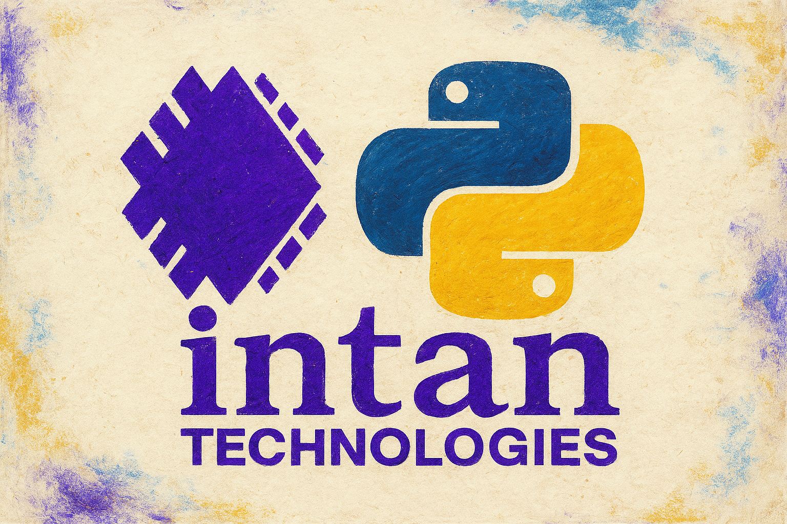

# python-intan

[](https://pypi.org/project/python-intan/)
[](https://pypi.org/project/python-intan/)
[](LICENSE)
[](https://neuro-mechatronics-interfaces.github.io/python-intan/)

`python-intan` provides Python tools for reading Intan RHD recordings, working with RHX TCP streams, processing EMG/electrophysiology signals, and building optional visualization and machine-learning workflows. Hardware examples require the relevant Intan or microcontroller hardware and are not exercised by a normal package installation.

## Quick links

- [Documentation](https://neuro-mechatronics-interfaces.github.io/python-intan/)
- [Examples](examples/)
- [Changelog](CHANGELOG.md)
- [Contributing](CONTRIBUTING.md)
- [Issue tracker](https://github.com/Neuro-Mechatronics-Interfaces/python-intan/issues)

## Features

- Read RHD files and Intan per-signal `.dat` recording directories.
- Load and save CSV and NPZ datasets.
- Connect to RHX software over its command and waveform TCP ports.
- Filter, normalize, repair, synchronize, and extract features from channel-by-sample data.
- Publish and subscribe to Lab Streaming Layer (LSL) streams.
- Plot multichannel data and run optional GUI viewers.
- Train and run optional PyTorch EMG models.

## Installation

Python 3.10 or later is required.

```bash
python -m pip install python-intan
```

The base install supports RHD/DAT/NPZ I/O, RHX/LSL streaming, and signal
processing. CSV/event tables, plotting, and scikit-learn are optional. To
retain the analysis features previously installed by default, use
`python -m pip install 'python-intan[analysis]'`.

For development from a repository checkout:

```bash
git clone https://github.com/Neuro-Mechatronics-Interfaces/python-intan.git
cd python-intan
python -m pip install -e '.[test]'
```

On Windows PowerShell, use double quotes around extras if your shell configuration does not accept single quotes.

## Optional dependencies

Install only the groups required by your workflow:

```bash
python -m pip install 'python-intan[data]'   # pandas CSV/event/metrics tables
python -m pip install 'python-intan[plot]'   # Matplotlib plots
python -m pip install 'python-intan[analysis]' # data, plotting, and scikit-learn PCA
python -m pip install 'python-intan[gui]'    # analysis features, PyQt5 and pyqtgraph
python -m pip install 'python-intan[ml]'     # analysis features and PyTorch
python -m pip install 'python-intan[video]'  # OpenCV and MediaPipe
python -m pip install 'python-intan[docs]'   # Sphinx documentation build
python -m pip install 'python-intan[test]'   # tests and release validation
```

The finger-kinematics landmark example can integrate with the separate `handtrack` project, but that project is intentionally not a package dependency. Install and evaluate it separately if you choose to run that example.

## Getting started

RHD data is represented with channels on axis 0 and samples on axis 1.

```python
from intan.io import load_rhd_file
from intan.processing import bandpass_filter, notch_filter

recording = load_rhd_file("path/to/recording.rhd")
emg = recording["amplifier_data"]
fs = recording["frequency_parameters"]["amplifier_sample_rate"]

filtered = notch_filter(emg, fs=fs, f0=60)
filtered = bandpass_filter(filtered, lowcut=20, highcut=450, fs=fs)
print(filtered.shape)
```

For RHX streaming, start the TCP server in Intan RHX software before connecting:

```python
from intan.interface import IntanRHXDevice

with IntanRHXDevice(num_channels=32, auto_start=False) as device:
    device.enable_wide_channel(range(32))
    device.start_streaming()
    window = device.get_latest_window(1000)
    print(window.shape)
```

## Synchronize with a digital pulse

Enable recording on the RHX digital input wired to the Pico. Start the
recording before triggering the Pico, and keep the LED visible to the cameras.
Read transitions without loading the amplifier data:

```python
from intan.io import read_digital_edges

for edge in read_digital_edges("trial.rhd", stream_id="rhx-bench"):
    if edge.line == 4:
        print(edge.segment, edge.sample_number, edge.sample_rate, edge.rising)
```

Lines are one-based, so line 4 corresponds to packed bit 3. Use the sample
number difference divided by the sample rate to compare pulse intervals
within a segment. Match the same sequence of rising and falling transitions
to the LED turning on and off in the video. Keep `time.dat` and the digital
input files beside `info.rhd` for split recordings. Gaps and counter resets
suppress transitions at the first sample after the discontinuity.

For live timing, enable only the amplifier waveforms and the desired digital
inputs under **Output to TCP** in RHX. The parser expects one 16-bit packed
input word after the amplifier samples in each frame. Set `num_channels`
to the number of streamed amplifier values. For example:

```python
from intan.interface import IntanRHXDevice, LSLOptions

def on_chunk(chunk):
    for edge in chunk.digital_edges:
        print(edge.sample_number, edge.rising)

with IntanRHXDevice(
    num_channels=32,
    digital_input_lines=(4,),
    on_chunk=on_chunk,
    use_lsl=True,
    lsl_options=LSLOptions(device_timestamps=True),
) as device:
    device.start_streaming()
    input("Press Enter to stop.\n")
```

The callback runs on the receive thread and also gets the samples, unwrapped
sample numbers, count of missing samples before the chunk, and host receipt
time. Keep callback work short. The optional LSL mode anchors the device
counter to the local LSL clock when the first chunk of each segment arrives
and advances it at the nominal sample rate. TCP latency affects that anchor
and hardware clocks can drift. Use the shared Pico pulse for measuring
alignment. The default LSL mode continues to timestamp chunks at send time.

## CLI usage

The optional GUI extra installs two console commands:

```bash
intan-emg-viewer --help
intan-trial-selector --help
intan-emg-viewer
intan-trial-selector
```

Most reproducible workflows are maintained as example CLIs. Run any command below from the repository root:

```bash
python examples/Read_Files/load_rhd_demo.py --help
python examples/Read_Files/load_dat_demo.py --help
python examples/gesture_classifier/1_build_dataset.py --help
python examples/gesture_classifier/2_train_model.py --help
python examples/gesture_classifier/3_predict.py --help
```

## Examples

The example folders distinguish package workflows from external hardware integrations:

- [`Read_Files`](examples/Read_Files/README.md): RHD, per-signal DAT, CSV, NPZ, and event segmentation.
- [`RHXDevice`](examples/RHXDevice/README.md): live RHX recording and plotting.
- [`LSL`](examples/LSL/README.md): LSL viewers and marker subscriptions.
- [`gesture_classifier`](examples/gesture_classifier/README.md): maintained dataset, training, and prediction CLIs.
- [`applications`](examples/applications/README.md): optional GUI applications.
- [`interface`](examples/interface/README.md): optional Pico IMU and combined hardware acquisition.
- [`finger_kinematics`](examples/finger_kinematics/README.md): optional video/landmark integration.
- [`exo_classifier`](examples/exo_classifier/README_PAPER_REPLICATION.md) and [`3D_printed_arm_control`](examples/3D_printed_arm_control/README.md): project-specific research and hardware examples; additional hardware/software may be required.

Examples that need data open a file picker or accept an explicit path. Microcontroller `.py` files and the bundled `.uf2` firmware are intended for their device runtimes, not desktop Python.

## Package structure

```text
intan/
├── applications/   optional GUI applications
├── decomposition/  PCA and constrained ICA utilities
├── interface/      RHX TCP, LSL, and optional Pico interfaces
├── io/             RHD, DAT, CSV, NPZ, event, and config I/O
├── ml/             lazy-loaded PyTorch model workflows
├── plotting/       static and real-time visualization
├── processing/     filtering, features, synchronization, and QC
├── samples/        packaged sample assets
└── ui/             shared optional GUI helpers
```

## Documentation

Published documentation is available on [GitHub Pages](https://neuro-mechatronics-interfaces.github.io/python-intan/). To build it locally, run these commands from a repository checkout. Documentation sources and media are kept in the repository rather than bundled in package distributions:

```bash
python -m pip install -e '.[docs]'
sphinx-build -W --keep-going -b html docs/source docs/build/html
```

## Development and testing

```bash
python -m pip install -e '.[test]'
python -m pytest
python -m compileall -q intan examples
python -m build
python -m twine check dist/*
```

Hardware, LSL, and interactive GUI behavior requires the corresponding devices, streams, or display server. The automated suite confines itself to deterministic offline and headless checks.

## Release workflow

1. Update the version consistently in `pyproject.toml`, `intan/__init__.py`, and `CITATION.cff`.
2. Update `CHANGELOG.md`, run the full validation commands above, and inspect both archives.
3. Commit the release changes, create a matching annotated `vX.Y.Z` tag, and rebuild from that clean tagged commit.
4. Upload to TestPyPI and validate an installation from TestPyPI.
5. Upload the exact already-validated artifacts to PyPI.

Do not reuse a version or rebuild artifacts between TestPyPI and PyPI.

## Contributing

Bug reports and focused pull requests are welcome. See [CONTRIBUTING.md](CONTRIBUTING.md) for environment and review guidance.

## License

`python-intan` is distributed under the [MIT License](LICENSE).
